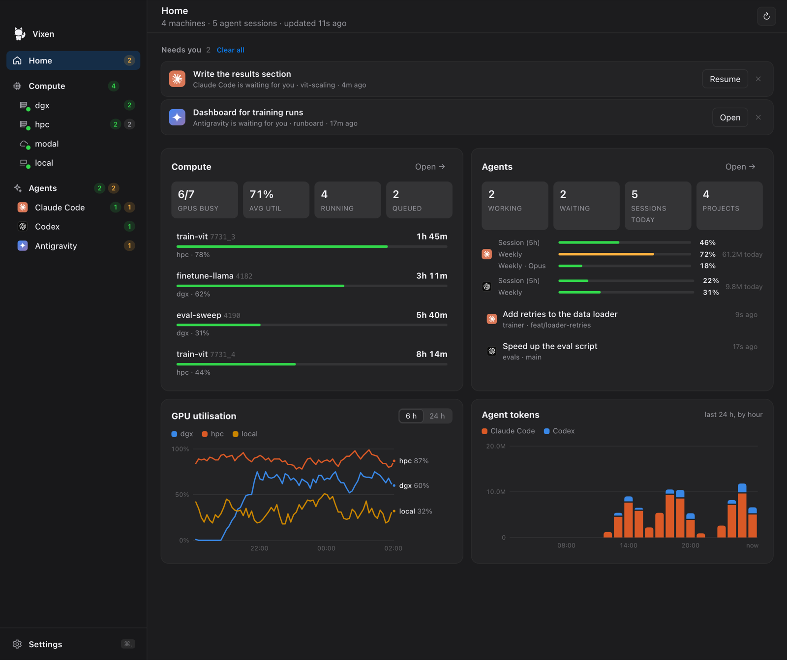
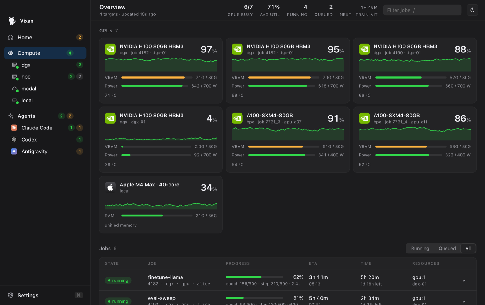
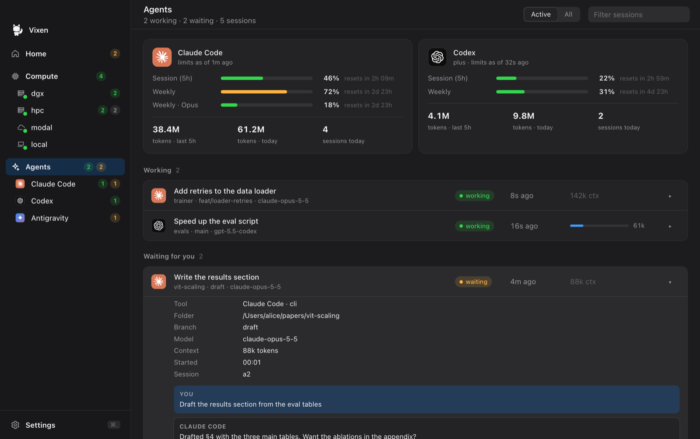
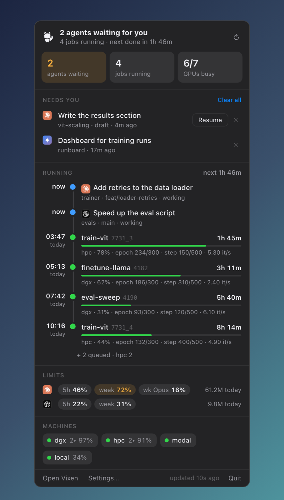
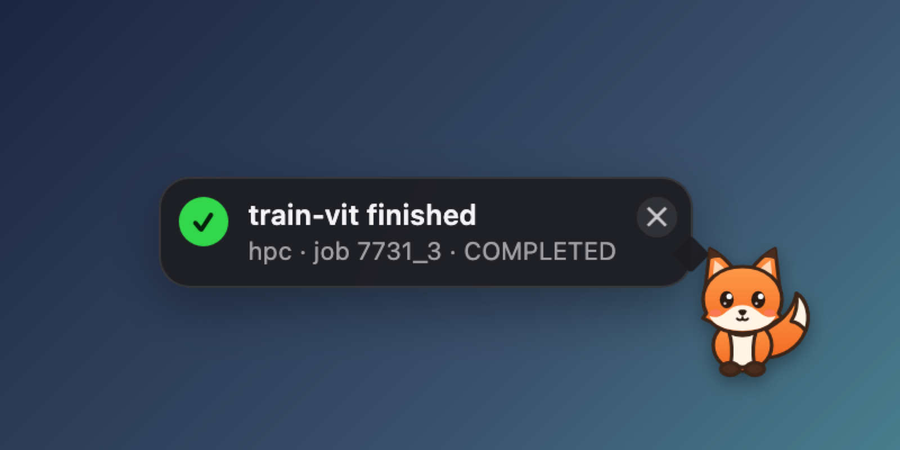

<p align="center">
  
</p>

<h1 align="center">Vixen</h1>

<p align="center">
  GPU, job and coding-agent monitoring for macOS, Linux and Windows.
</p>

<p align="center">
  <a href="https://github.com/kleyt0n/vixen/actions/workflows/ci.yml"></a>
  <a href="https://github.com/kleyt0n/vixen/releases/latest"></a>
  <a href="LICENSE"></a>
  
</p>

Vixen keeps your compute and your coding agents in one place. It watches GPUs and jobs on SSH hosts, Slurm and SGE clusters, cloud GPU providers and your own machine. It also tracks Claude Code, Codex and Antigravity sessions with their plan limits and token use. It ships as a native macOS menu-bar app and a cross-platform command-line tool, built on a single Rust core.

```bash
# install macOS/Linux
curl -fsSL https://raw.githubusercontent.com/kleyt0n/vixen/main/scripts/install.sh \| sh
```

```bash
# Windows
irm https://raw.githubusercontent.com/kleyt0n/vixen/main/scripts/install.ps1 \| iex
```

<p align="center">
  
</p>

## Features

### Compute

- **GPU telemetry**: utilisation, memory, power and temperature per GPU, including GPUs allocated to running Slurm jobs, with utilisation history per machine.
- **Job tracking**: running, pending and held jobs, with progress and ETAs parsed from training logs (tqdm, `epoch a/b`, `step a/b`, `it/s`), and warnings before a job exceeds its time limit.
- **Job control**: cancel, hold and release jobs, and follow their logs.
- **Efficient polling**: one SSH round trip per poll, reusing existing `ControlMaster` connections.



### Coding agents

- **Session state**: each Claude Code, Codex and Antigravity session is shown as working, waiting for input or idle, with project, branch, model and context usage.
- **Plan limits and tokens**: session and weekly limits per tool, plus token usage today and by hour.
- **Quick actions**: resume a session in Terminal, open its working directory or reveal its transcript.



### Menu bar and notifications

- **Menu-bar panel**: what needs attention, a timeline of running work, plan limits and machine status.
- **Notifications**: alerts when a job finishes or fails, an agent is waiting, or a plan limit passes a configurable threshold.
- **Floating companion** (optional): an on-screen fox that announces job and limit events.

<p>
  
  &nbsp;&nbsp;
  
</p>

## Installation

| Platform | Command |
|---|---|
| macOS, Linux | `curl -fsSL https://raw.githubusercontent.com/kleyt0n/vixen/main/scripts/install.sh \| sh` |
| Windows (PowerShell) | `irm https://raw.githubusercontent.com/kleyt0n/vixen/main/scripts/install.ps1 \| iex` |

The installer verifies downloads against the release checksums. It installs:
- the `vixen` CLI, in `~/.local/bin` (Windows: `%LOCALAPPDATA%\vixen\bin`);
- on macOS, **Vixen.app**;
- a starter configuration.

To build from source, run `make install` (requires Rust; the app also needs `cargo install tauri-cli --version "^2" --locked`).

## Quick start

1. Run `vixen init` to create `~/.config/vixen/config.toml`.
2. Add your machines in **Settings** (`⌘,`) or in the file, using host aliases from `~/.ssh/config`:

   ```toml
   [[target]]
   name      = "dgx"
   host      = "dgx"
   scheduler = "slurm"
   host_gpus = true
   ```

3. Open **Vixen.app**, or run `vixen` in a terminal.

Every option is documented in [`config/example.toml`](config/example.toml).

## Supported sources

| Compute | How it is read |
|---|---|
| SSH host | `nvidia-smi` or `amd-smi` over SSH |
| Slurm | `squeue`, `scontrol`, `sacct`; in-job GPUs via `srun --overlap` |
| SGE | `qstat`, `qacct` |
| Modal, Vast.ai, SkyPilot | each provider's CLI |
| This Mac | Apple GPU via `ioreg` |

| Agent | How it is read |
|---|---|
| Claude Code | session files in `~/.claude` |
| Codex | session files in `~/.codex` |
| Antigravity | conversation index in `~/.gemini/antigravity` (read-only) |

## Command line

| Command | Description |
|---|---|
| `vixen` | Status of every target |
| `vixen watch` | Live view |
| `vixen agents` | Agent sessions, plan limits and token usage |
| `vixen logs <target> <job>` | Tail a job's output |
| `vixen cancel \| hold \| release <target> <job>` | Control a job |
| `vixen targets` | List configured targets |
| `vixen init` | Create the configuration file |

## Privacy and security

- **Local-only agents:** agent data is read from local files and is never uploaded.
- **Plain SSH:** remote machines are reached with your own SSH configuration, in batch mode, so Vixen never prompts for passwords.
- **Live Claude limits (opt-in, off by default):** this reuses Claude Code's saved login to fetch current plan limits. The token is passed on standard input, never on the command line, and is never refreshed or stored by Vixen.

## Development

| Task | Command |
|---|---|
| Build the macOS app | `make app` |
| Run tests | `make test` |
| Lint and format check | `make lint` |
| Regenerate screenshots (demo data) | `make screenshots` |
| List all tasks | `make help` |

Pushing a `v*` tag builds and publishes a release for macOS, Linux and Windows.

## License

[MIT](LICENSE)
